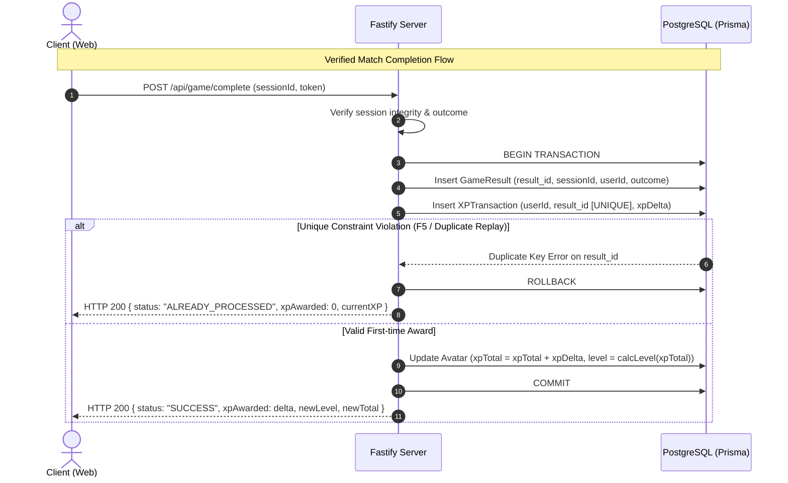

# Phase 2: Auth and Avatar XP Engine

## Overview
Implement user authentication (Registration, Login, Session Management with JWT), player profile management, and the core Avatar Progression & Idempotent XP Engine. This guarantees persistent cross-game identity and prevents duplicate XP exploit when refreshing or replaying requests.

## Requirements
- **Functional Requirements:**
  - `FR-AUTH-01..03`: Register with email, unique nickname, and password; login returning secure HttpOnly JWT; protect private endpoints.
  - `FR-AUTH-04 / DEC-01`: Guest session creation with ephemeral token, allowing smooth migration to registered account if desired.
  - `FR-AV-01..04`: Each registered player has exactly one avatar with customizable cosmetic properties (color, hat, glasses) and accumulated XP/Level.
  - Idempotent XP Transaction: Calculate and award XP upon verified match completions; ensure duplicate requests with the same `resultId` never award XP twice.
- **Non-Functional Requirements:**
  - Password hashing with `bcrypt` or `argon2`.
  - Atomicity in database transactions: awarding XP, updating avatar total, and creating `XPTransaction` occur in a single ACID transaction.
  - Strict input validation using Zod.

## Architecture

## Related Code Files
- Create: `apps/server/src/modules/auth/auth.routes.ts`
- Create: `apps/server/src/modules/auth/auth.service.ts`
- Create: `apps/server/src/modules/auth/jwt.plugin.ts`
- Create: `apps/server/src/modules/avatar/avatar.routes.ts`
- Create: `apps/server/src/modules/avatar/avatar.service.ts`
- Create: `apps/server/src/modules/avatar/xp.calculator.ts`
- Create: `apps/web/src/lib/auth-client.ts`
- Create: `apps/web/src/hooks/use-auth.ts`
- Create: `apps/web/src/components/avatar/avatar-display.tsx`
- Create: `apps/web/src/components/avatar/avatar-customizer.tsx`

## Implementation Steps
1. **Auth Service Implementation:**
   - Password hashing with `bcryptjs`.
   - Endpoints: `POST /api/auth/register`, `POST /api/auth/login`, `POST /api/auth/logout`, `GET /api/auth/me`.
   - Set JWT cookie with `httpOnly: true`, `secure: process.env.NODE_ENV === 'production'`, `sameSite: 'lax'`.
2. **Avatar System Implementation:**
   - Default avatar created upon user registration (`color: 'retro-yellow'`, `hat: 'none'`, `xpTotal: 0`, `level: 1`).
   - Endpoints: `GET /api/avatar/me`, `PATCH /api/avatar/me` (update cosmetic items).
   - Validation ensuring only unlocked cosmetic items or approved palette colors can be chosen.
3. **Idempotent XP Engine:**
   - Define leveling curve in `xp.calculator.ts`:
     $$\text{Level}(XP) = \left\lfloor\sqrt{\frac{XP}{100}}\right\rfloor + 1$$
   - Implement `awardXP(userId, resultId, reason, amount)` wrapped in Prisma `$transaction`.
   - Catch Prisma error code `P2002` (unique constraint on `XPTransaction.resultId`) to gracefully return existing balance without error.
4. **Client Auth Integration:**
   - Create React context/hook `useAuth()` managing user state and avatar details.
   - Design retro-styled Avatar component using SVG layers (body, eyes, accessories, color themes).

## Success Criteria
- [ ] User can register, log in, and view personal avatar state.
- [ ] Submitting the same completion payload 10 times concurrently results in exactly one XP award and 9 idempotent responses.
- [ ] Level automatically recalculates when XP crosses milestone thresholds.
- [ ] Avatar appearance updates persist across page reloads.

## Risk Assessment
- **Risk:** Race condition when multiple games finish in rapid succession.
  - *Mitigation:* Database-level row locking (`SELECT ... FOR UPDATE` or Prisma `$transaction` with optimistic concurrency) on the Avatar row.
- **Risk:** Token leakage via XSS.
  - *Mitigation:* Store tokens exclusively in HttpOnly, SameSite cookies.
