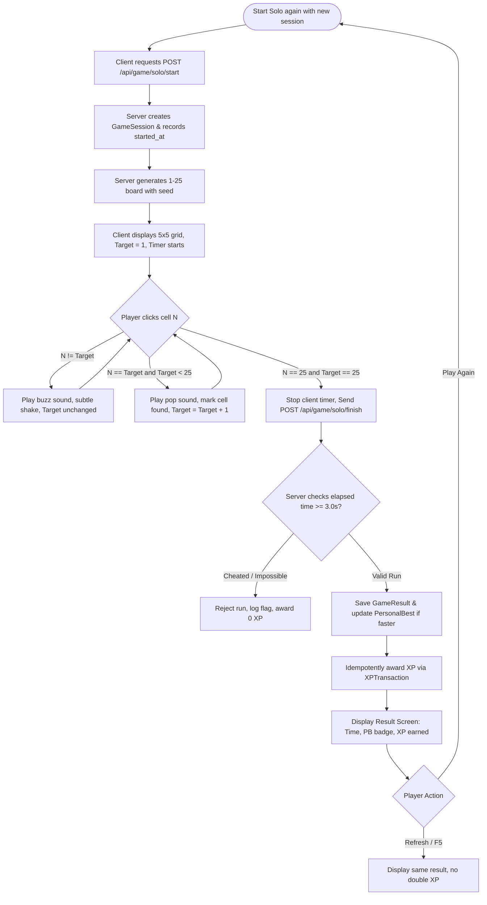

# Phase 4: Number Hunt Solo

## Overview
Implement the complete single-player Number Hunt game: randomized 1–25 grid generation, sequential clicking interaction, millisecond precision stop-watch, anti-cheat server verification, post-game results screen, personal record persistence, and frictionless "Play Again" flow.

## Requirements
- **Functional Requirements:**
  - `FR-NH-01..04`: 5x5 grid containing numbers 1 to 25 shuffled uniformly. Board must advance only when the exact required number is selected ($1 \to 2 \to \dots \to 25$).
  - `FR-NHS-01..04`: Timer starts on first valid click or start trigger; elapsed time measured in milliseconds; completion on selecting 25.
  - `FR-RES-01..04`: Post-game modal showing elapsed time, new personal record badge (if beat previous record), XP earned, and prominent "Play Again" button.
  - `DEC-07 / Anti-Cheat`: Server issues session token at start; client submits completion; server verifies sequence elapsed time against physical human minimums ($> 3.0$ seconds).
- **Non-Functional Requirements:**
  - `NFR-UX-01..02`: Immediate tactile and audio feedback on each number clicked ($< 50$ms perceived latency).
  - High contrast cell highlighting: Selected numbers dim or disappear; current target number is tracked.
  - Mobile touch support: Cells must not double-zoom or trigger unwanted gestures on double tap.

## Architecture & BPMN Workflow

## Related Code Files
- Create: `apps/web/src/app/play/number-hunt/solo/page.tsx`
- Create: `apps/web/src/components/game/number-grid.tsx`
- Create: `apps/web/src/components/game/number-cell.tsx`
- Create: `apps/web/src/components/game/timer-display.tsx`
- Create: `apps/web/src/components/game/result-modal.tsx`
- Create: `apps/server/src/modules/game/solo/solo.routes.ts`
- Create: `apps/server/src/modules/game/solo/solo.service.ts`
- Create: `apps/server/src/modules/game/solo/board-generator.ts`

## Implementation Steps
1. **Board Generator (`board-generator.ts`):**
   - Implement Fisher-Yates shuffle algorithm seeded with cryptographic random numbers.
   - Output 25 integers array in random sequence.
2. **Backend Solo Controller & Anti-Cheat:**
   - `POST /api/game/solo/start`: Generates `GameSession` in PostgreSQL with `gameType = 'NUMBER_HUNT'`, `mode = 'SOLO'`, `status = 'ACTIVE'`, and `startedAt = new Date()`. Returns `sessionId` and `board`.
   - `POST /api/game/solo/finish`: Accepts `sessionId` and client reported time.
   - Computes `serverElapsed = now - session.startedAt`.
   - Validates $|serverElapsed - clientTime| \le 1500\text{ms}$ and $serverElapsed \ge 3000\text{ms}$.
   - Upserts `PersonalBest` if `completionTimeMs < existingBest`.
   - Idempotently awards XP ($+10$ base, $+15$ bonus if under 30s).
3. **Frontend Grid & Interaction Component:**
   - Responsive CSS Grid `grid-cols-5 gap-2 md:gap-3` with square aspect ratio cells.
   - Animated visual feedback on click (scale effect, green pulse for correct, red vibration for wrong).
   - Display prominent "Current Target" indicator above board ($1 \to 25$).
4. **Result Modal & Instant Replay Flow:**
   - Show completion time formatted as `MM:SS.mmm`.
   - "Personal Best" gold stamp if updated.
   - XP progress animation showing +XP filling current level bar.
   - "Chơi Lại (Play Again)" primary button which immediately requests a new session and resets the board in place without full page reload.

## Success Criteria
- [ ] Completing numbers 1 to 25 correctly triggers the finish API and displays the result modal.
- [ ] Selecting out-of-order numbers (e.g. clicking 5 when target is 2) does not advance the state and provides immediate feedback.
- [ ] Completing in a faster time updates the player's personal record in the database.
- [ ] Clicking "Chơi Lại" generates a new board and resets the timer in under 300ms.
- [ ] Refreshing the result page does not duplicate XP rewards.

## Risk Assessment
- **Risk:** Automated click bots or client scripts manipulating the timer.
  - *Mitigation:* Server enforces authoritative start timestamp; submissions under 3.0 seconds are flagged and rejected.
- **Risk:** Mobile input lag on touch devices.
  - *Mitigation:* Use `pointerdown` / `touchstart` events with `touch-action: manipulation` to prevent the standard 300ms click delay.
