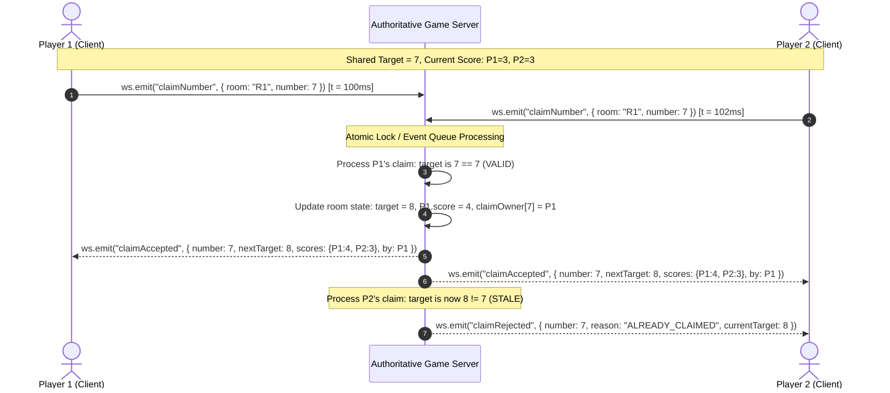

# Phase 5: Number Hunt PvP Realtime

## Overview
Develop the real-time two-player Number Hunt PvP experience: room creation and invite links/codes, lobby readiness synchronization, simultaneous competition on a shared board, authoritative atomic claim arbitration on concurrent clicks, real-time score streaming, disconnect/reconnection handling, and match conclusion.

## Requirements
- **Functional Requirements:**
  - `FR-NHP-01..07`: Two players join the same room; both see identical 1–25 board arrangements; play simultaneously without turn alternation; both can claim consecutive numbers.
  - `FR-NHP-04 / DEC-03`: Server-authoritative atomic claim arbitration. When both players click the required number at the same time, the server atomically accepts exactly one claim, awards +1 point to the first claimant, advances target to $k+1$, and notifies both clients.
  - `FR-NHP-05..06`: Match concludes when all 25 numbers are claimed; highest score wins (e.g. 13–12); draw handling defensive fallback; no clicks accepted after game over.
  - `FR-NHP-08 / DEC-04`: Disconnection grace period (15s); if opponent fails to reconnect within grace period, remaining player is awarded win by forfeit.
- **Non-Functional Requirements:**
  - `NFR-RT-01..02`: Low latency state broadcast via WebSockets ($< 100$ms roundtrip on typical broadband/4G).
  - Concurrency safety: Zero race conditions; board target must advance monotonically from 1 to 26; total points awarded must strictly equal 25.

## Architecture & BPMN Dispute Resolution



## Related Code Files
- Create: `apps/server/src/socket/room.manager.ts`
- Create: `apps/server/src/socket/pvp-game.handler.ts`
- Create: `apps/server/src/socket/events.ts`
- Create: `apps/web/src/hooks/use-pvp-socket.ts`
- Create: `apps/web/src/app/play/number-hunt/pvp/page.tsx`
- Create: `apps/web/src/components/game/pvp-lobby.tsx`
- Create: `apps/web/src/components/game/pvp-board.tsx`
- Create: `apps/web/src/components/game/pvp-scoreboard.tsx`

## Implementation Steps
1. **WebSocket Room Engine (`room.manager.ts`):**
   - In-memory or Redis-backed state machine:
     - `rooms: Map<string, RoomState>`
     - `RoomState`: `{ id, code, hostPlayer, guestPlayer, status: 'WAITING'|'READY'|'COUNTDOWN'|'PLAYING'|'FINISHED', board, targetNumber: 1, scores: { [id]: number }, disconnectTimers }`
   - Room code generator: 6-char alphanumeric code (e.g. `NH-8942`).
2. **Lobby & Match Synchronization:**
   - Events:
     - `room:create` -> Returns room code & shareable link.
     - `room:join` -> Validates room is not full (max 2 players); broadcasts `room:player_joined`.
     - `room:ready_toggle` -> When both players are ready, server initiates 3-2-1 countdown and emits `match:start` with shared board.
3. **Atomic Claim Arbitration (`pvp-game.handler.ts`):**
   - Handle `match:claim`:
     ```typescript
     // Pseudocode inside synchronized handler
     if (room.status !== 'PLAYING') return;
     if (number !== room.targetNumber) {
       socket.emit('claim:rejected', { number, reason: 'INVALID_NUMBER' });
       return;
     }
     // Valid claim
     room.scores[playerId] = (room.scores[playerId] || 0) + 1;
     room.claimedCells[number] = playerId;
     room.targetNumber += 1;

     io.to(room.id).emit('claim:accepted', {
       claimedNumber: number,
       claimedBy: playerId,
       nextTarget: room.targetNumber,
       scores: room.scores
     });

     if (room.targetNumber > 25) {
       room.status = 'FINISHED';
       handlePvPGameOver(room);
     }
     ```
4. **Match Conclusion & Persistence:**
   - Determine winner (player with $\ge 13$ points).
   - In single DB transaction, persist `GameSession`, `GameResult`, and award $+50$ XP to winner, $+15$ XP to loser.
   - Emit `match:game_over` with final summary.
5. **Disconnect & Reconnect Grace Period:**
   - On socket disconnect: Start 15s timer; emit `player:disconnected` to remaining player.
   - If player reconnects within 15s with same session token: cancel timer, resend full current state snapshot (`targetNumber`, `scores`, `claimedCells`), resume match.
   - If timer expires: declare remaining player winner by default.

## Success Criteria
- [ ] Two separate browser windows can join the same room via code or URL.
- [ ] Both players see identical number arrangement on their screens.
- [ ] Rapid simultaneous clicking on the same number results in exactly one point awarded and synchronized state on both screens.
- [ ] Sum of final scores always equals 25.
- [ ] Disconnecting one player triggers a 15-second countdown on the opponent's screen, and reconnecting restores the board without data corruption.

## Risk Assessment
- **Risk:** High network latency causing one player to feel disadvantaged.
  - *Mitigation:* Visual indicator of opponent's recent claim with distinctive color coding (Player 1 = Blue highlight, Player 2 = Amber highlight) so both players clearly see claim updates in real-time.
- **Risk:** Socket memory leaks from abandoned rooms.
  - *Mitigation:* Automatic cleanup TTL: delete inactive rooms after 10 minutes of inactivity.
