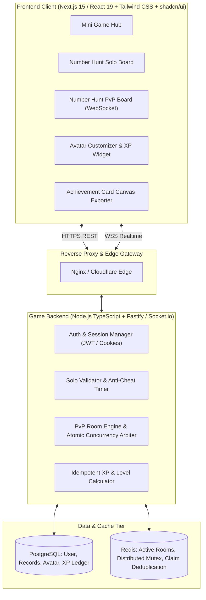

# Nostalgic Mini Game Platform Implementation Plan

## Executive Summary & Vision

**Nostalgic Mini Game Platform** is a browser-based, quick-play casual gaming platform built by a team of 4 software engineering students at FPT University over a 4–8 week horizon. The platform is designed around the core value journey:
$$\text{Attract (Nostalgia)} \longrightarrow \text{Engage (Quick-Play \& Replayability)} \longrightarrow \text{Return \& Share (Avatar \& Records)}$$

- **Primary Entry Point:** High-nostalgia schoolyard games (Number Hunt 1–25, Caro, Memory Matching).
- **Core Value Metric:** Low friction to start ($\le 2$ clicks), responsive $\le 2$-minute sessions, immediate feedback, frictionless "Play Again" loop.
- **Cross-Game Retention Layer:** Unified persistent player identity, XP/level progression, customizable avatar cosmetics, and shareable verified achievement cards.
- **Architectural Benchmark:** Benchmarked against successful casual real-time platforms like *Papergames.io*, *Jstris*, *Skribbl.io*, and *Lichess* (authoritative game server, lock-step/atomic claim ordering, anti-cheat validation, and strict idempotency).

---

## Architectural Principles & Technical Stack

Based on the team constraints (.NET & Node.js backgrounds, 4–8 week delivery horizon, requirement for zero-install mobile/desktop web browser access, and real-time PvP concurrency):

1. **Frontend:** Next.js 15 (App Router) + React 19 + TypeScript + Tailwind CSS + shadcn/ui + Lucide Icons + Canvas API / `html-to-image` for social cards + Howler.js for retro 8-bit sound effects.
2. **Backend & Real-time Server:** Node.js (TypeScript) + Fastify (REST API) + Socket.io / WebSocket Server. Shared TypeScript schemas via monorepo (`packages/shared-types`).
3. **Database & Cache:** PostgreSQL (Prisma ORM / Drizzle) with strict uniqueness constraints and transactional guarantees; Redis for atomic locks and in-memory room state management.
4. **Methodology:** Hybrid Spec-Driven Development (SDD) & Agent-Driven Development (ADD), with human gatekeeper reviews.

---

## Phases Roadmap

| Phase | Name | Status | Deliverables |
|:---:|:---|:---:|:---|
| 1 | [Foundation and Architecture](./phase-01-foundation-and-architecture.md) | Completed | Monorepo structure, shared types, DEC-01..10 resolution, Docker compose |
| 2 | [Auth and Avatar XP Engine](./phase-02-auth-and-avatar-xp-engine.md) | Completed | Auth endpoints, Avatar profile, XP ledger with idempotency guarantees |
| 3 | [Core Hub and UI](./phase-03-core-hub-and-ui.md) | Completed | Game Hub UI, retro design system, audio engine, responsive layouts |
| 4 | [Number Hunt Solo](./phase-04-number-hunt-solo.md) | Completed | 1–25 Fisher-Yates generator, anti-cheat timer, result screen, Play Again |
| 5 | [Number Hunt PvP Realtime](./phase-05-number-hunt-pvp-realtime.md) | Completed | Socket.io rooms, atomic claim arbiter, sync state, disconnect resilience |
| 6 | [Extended Features](./phase-06-extended-features.md) | Completed | Achievement card canvas export, Caro 5-in-a-row PvP, Memory Matching |
| 7 | [Hardening Deployment & Playtesting](./phase-07-hardening-deployment-and-playtesting.md) | Completed | CI/CD pipelines, playtesting protocol for 50-100 users, deploy guide |

---

## Strategic Decision Register (Resolving DEC-01 to DEC-10)

| Decision ID | Topic | Resolution for Implementation |
|:---|:---|:---|
| **DEC-01** | Guest Policy | Guests can play Solo immediately without login; temporary records stored in localStorage; prompt to register to save high scores & earn XP. PvP requires authenticated user or guest temporary nickname. |
| **DEC-02** | Room Join/Ready | 6-character room codes (`ABC123`) or shareable URL (`/play/nh/pvp?room=XYZ`). Both players must click "Ready" before a 3-second countdown starts. |
| **DEC-03** | Atomic Claim Ordering | First claim received by authoritative server wins (Redis lock / Node event loop serial execution). Winner gets +1 point, board advances to $k+1$. Stale claims receive `ALREADY_CLAIMED` without penalty. |
| **DEC-04** | Disconnection Handling | 15-second grace period for disconnected player to reconnect. If timeout expires, active player wins by forfeit. |
| **DEC-05** | XP & Leveling Formula | Win PvP: $+50$ XP; Complete Solo ($<30$s): $+25$ XP; Solo completion: $+10$ XP. Level threshold: $\text{Level}(XP) = \lfloor\sqrt{XP / 100}\rfloor + 1$. Unique constraint on `result_id` prevents F5 spam abuse. |
| **DEC-06** | Auth Lifecycle | Email + password with JWT in secure HttpOnly cookies; optional guest token; profile update for public nickname. |
| **DEC-07** | Solo Timer & Anti-Cheat | Server records `started_at` at game start; client sends completion timestamp; server verifies $time \ge 3.0\text{s}$ and sequence order. Unrealistic completion times ($<3\text{s}$) rejected as cheated. |
| **DEC-08** | Platform Compatibility | Responsive web design for Chromium, Safari, Firefox; touch-friendly 5x5 grid cells on mobile devices ($\ge 48\text{px}$ touch targets). |
| **DEC-09** | Cloud Deployment | Vercel / Cloudflare Pages for Frontend; Railway / Fly.io / Render for WebSocket Backend + Managed Postgres. |
| **DEC-10** | Usability Metric Target | First game launch in $< 3$ clicks and $< 10$ seconds from landing on site. |

---

## Traceability to Project Specifications

- **Ideation Document v1.0**: Aligned with Sections §1 (Overview), §5 (Number Hunt & Priority Games), §7 (Avatar System), §8 (Core vs Extended MVP), §9 (Constraints).
- **Executable Specification v1.0**: Fully conforms to EARS requirements `FR-HUB`, `FR-AUTH`, `FR-NH`, `FR-NHS`, `FR-NHP`, `FR-RES`, `FR-AV`, and Non-Functional Requirements `NFR-RT-01..02`, `NFR-SEC-01..02`, `NFR-REL-01`.
- **BPMN Workflows**: Directly reflects diagrams for Solo Number Hunt, PvP Concurrent Resolution, and Play Again Idempotency.
